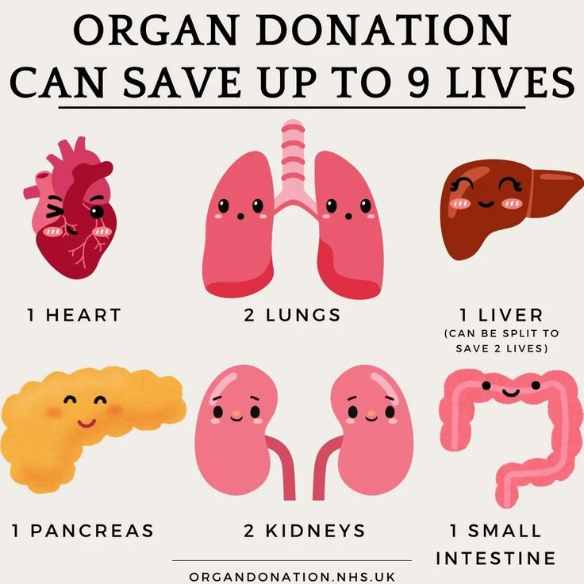
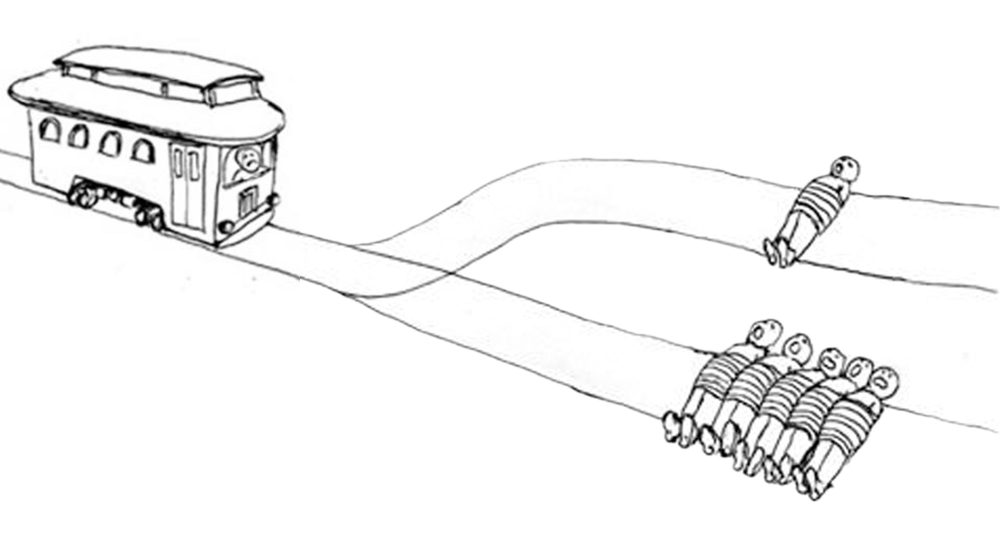
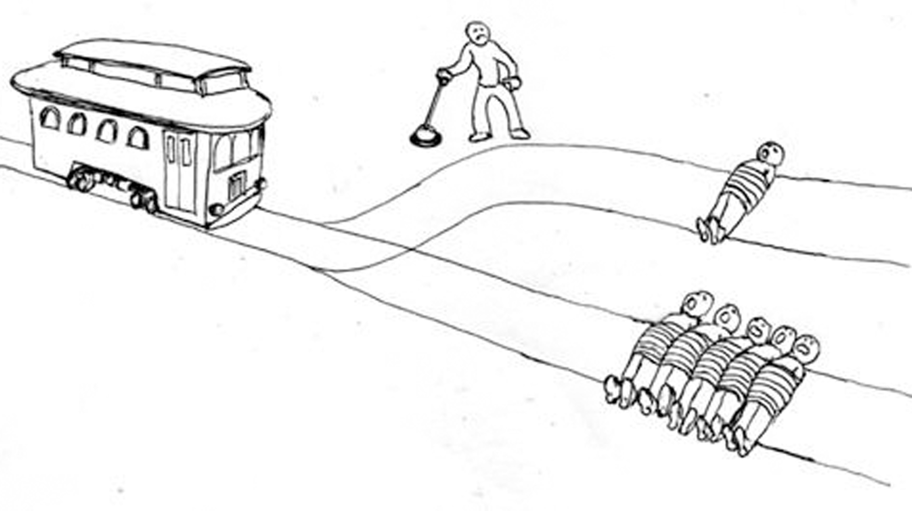

# Preliminaries

## Announcements

-  We need to decide on topics for the last two weeks.
-  Final Exam time: 3:35pm section:M 12/7, 10:00am--noon in this room.
-  How to find this info on [my.illinoisstate.edu](https://my.illinoisstate.edu)

# Topics

## Ideas?

PLEASE REMIND ME TO SAVE WHATEVER WE COME UP WITH!!!

:::notes

-  moral relativism
-  cultural appropriation
-  aesthetic taste
-  happiness and career choice
-  immoral art
-  philosophy of games
-  bullshit
-  what (if anything) gives life meaning? 
-  time is not real
-  change is impossible: Zeno's paradoxes
-  Is virtual reality real?
-  Does AI understand what it is talking about?
-  Can machines think?
-  Would it be good or bad to be immortal?
-  Divine foreknowledge and free will
-  Paradoxes of material constitution: heaps, Ship of Theseus, statue and clay, Tibbles and Tib

:::

# Right and Wrong

## What We Seek

> A perfectly general answer to the question of which things are right and
> wrong, an answer that identifies what makes right actions right and wrong
> actions wrong.

## {.center}

Consequentialism
:  What makes an act right or wrong is a matter of its *consequences*: a right act is one that has good results; a wrong act is one that has bad results.

:::notes
get them to think about the difference between 'right' and 'good' and 'wrong' and 'bad'.
:::

---

Deontology
:  What makes an act right or wrong has to do with more than just its consequences---there are some things you are *obligated* to do regardless of consequences; there are some things you are *permitted* to do regardless of consequences.

---

Act Utilitarianism
:   Performing a certain action is the right thing to do if and only if it
    will have a more positive effect on overall **levels of happiness** than any
    other available action.

. . .

Happiness as Pleasure
:   Happiness is any physically or emotionally pleasurable mental state; unhappiness is any physically or emotionally unpleasant mental state.

:::notes
-   this is a form of consequentialism---what makes a something good or bad is how much overall happiness is produces.
:::

---

Act Utilitarianism
:   Performing a certain action is the right thing to do if and only if it
    will have a more positive effect on **overall** levels of happiness than any
    other available action.

Ethical Egoism
:   Performing a certain action is the right thing to do if and only if it
    will have a more positive effect on **the agent's** level of happiness than any other available action.

---

Act Utilitarianism
:   Performing a certain action is the right thing to do if and only if it
    will have a more positive effect on overall levels of happiness than any
    other available action.

Rule Utilitarianism
:   Performing a certain action is the right thing to do if and only if it is
    prescribed by the collection of rules that, if adopted, would have the
    greatest positive effect on overall levels of happiness

:::notes
-   AU is the simplest form of U. RU is a more complicated alternative.
-   RU is still a form of consequentialism---what ultimately matters are the consequences of the rules.
:::

# Why Act Utilitarianism?

## Explaining Cases

Cheating on your romantic partner is wrong. 
Why? 

. . .

Because it leads to so much emotional pain, in exchange for a comparably
small and short-lived amount of sexual gratification. 

---

I promise to drive you to the airport in the morning.
It is wrong to break my promise because I don't feel like getting up.
Why?

. . .

Because your financial loss and distress over missing your flight has a bigger
negative effect on overall happiness (taking into account both yours and mine)
than does dragging myself out of bed.

---

I promise to drive you to the airport in the morning.
It is not wrong to break my promise if someone has a heart attack and I need to rush him to the hospital instead.
Why?

. . .

Because leaving him
to die would have had a greater negative effect on the overall level of
happiness of all involved (including yours, mine, his, and his family and
friends') than you missing your flight.

## Absurd Disconnect

Suppose AU is false. Then:

1.  Sometimes, it is *wrong* to perform the *best* act---the act that makes the world a better place
than any other available act.
2.  Sometimes, it is *right* to perform a *worse* act---an act that makes the world worse than it would be if you had done something else.

But (1) and (2) are absurd. So AU is true.

## Egalitarianism

**Everyone**'s happiness counts equally.

Oppressive laws and practices---sexist, racist, homophobic, transphobic, etc.---have a dramatic negative effect on the happiness of the oppressed, and this outweighs any positive effect they have on the happiness of others---so they are therefore wrong.

(Historically, Act Utilitarians have been important advocates for social reform.)

## Subjectivity, Relativity, and Objectivity

It is a truism that morality is subjective and relative. But there is also pressure to think that some moral demands are objective and absolute. Act Utilitarianism can explain this.

## Subjectivity and Relativity

What makes you happy is **subjective**. Different people find pleasure in different things.

So morality is both subjective and relative: facts about what is right and wrong are relative to, and must respect, these subjective differences.

:::notes
Tipping in Japan vs. US
:::

## Objectivity

::: {#example-condoned-lobotomies .example}
## CONDONED LOBOTOMIES {-}

The leaders of a certain oppressive country instituted a law that requires
all newborn girls to be lobotomized. Dissenters were lobotomized as well.
After a few generations, there are no more dissenters. The men are all happy
with the arrangement, and the women are all lobotomized and have no opinion
on the matter.

:::

What matters for right and wrong is not what people **believe** makes them happy, but what actually makes them **happy**. So in this sense, right and wrong are objective.

# Organ Distribution

## {.center}

:::notes
::: {#example-organ-distribution .example}
## ORGAN DISTRIBUTION {-}

Jonathan is a doctor, and his patient Nick is coming in for a routine
physical. Looking over his past bloodwork, Jonathan realizes that Nick's
organs are an exact match for five patients in critical condition upstairs in
the Intensive Care Unit. When Nick arrives, Jonathan kills him (painlessly),
making it look like an accident. Since Nick is an organ donor, his body is
rushed upstairs, and his heart, lungs, liver, and each of his kidneys are
successfully transplanted into those five patients, saving their lives. No
other organs arrived that day, and the five patients would have died had
Jonathan not killed Nick for his organs. The five patients all go on to lead
long, happy lives. No one ever finds out that Nick's death was not an
accident.

:::
:::

## The Organ Distribution Argument {-}

::: {#argument-OD .argument}

- (OD1) Killing Nick has a greater positive effect on overall levels of
  happiness than letting him live.
- (OD2) If killing Nick has a greater positive effect on overall levels of
  happiness than letting him live, then: if act utilitarianism is true, then
  killing Nick was the right thing to do.
- (OD3) Killing Nick was not the right thing to do.
- (OD4) So, act utilitarianism is false.

:::

Objections?

## 

Rule Utilitarianism
:   Performing a certain action is the right thing to do if and only if it is
    prescribed by the collection of rules that, if adopted, would have the
    greatest positive effect on overall levels of happiness

Maybe we can explain why killing Nick was wrong by shifting to Rule Utilitarianism instead?

---

Brainstorm: What are some rules that, if adopted, would have a positive effect on overall levels of happiness?

:::notes
- Don't kill innocent people
- Don't steal
- Don't lie
- Don't break promises
- Treat people fairly
:::

---

1. Don't kill innocent patients unless by doing so I can save multiple lives.
2. Never kill innocent patients.

If doctors adopt rule (1), people would be terrified to go to the hospital, and overall happiness would decrease. So they should adopt rule (2).

---

1. Don't break a promise unless something more important comes up.
2. Don't ever break promises.

If we adopt rule (1), the institution of making promises will be destroyed, and we will lose the good things that depend on it, so our overall happiness will decrease. So we should adopt rule (2).

---

Can the Rule Utilitarian hold both that killing the patient to save five was morally wrong **and** that breaking a promise to rush someone to the hospital was morally right?

## Rules for Promising

1. Don't break a promise unless something more important comes up.
2. Don't ever break promises.
3. Don't break a promise **unless you need to save someone who is having a heart attack by driving them to the hospital**.

Adopting rule (3) over rule (2) saves the man with the heart attack and avoids putting the whole institution of making promises at risk. So we should adopt (3). So it was right to break the promise.

## Rules for Harvesting

1. Don't kill innocent patients unless by doing so I can save multiple lives.
2. Never kill innocent patients.
3. Don't kill innocent patients unless **nobody will ever find out** and by doing so I can save multiple lives.

(Secretly) adopting rule (3) saves the five and avoids scaring off patients from doctors. So should adopt rule (3) over rule (2). So it was right for the doctor to harvest Nick's organs.

---

The Rule Utilitarian has a **specificity** problem. Right and wrong depends on how specific the rules can be.

And, however she resolves this, it is hard to see how she can claim that killing Nick was wrong but breaking the promise was right:

- If rules must be fairly general, then it is never right to break promises.
- If rules can be rather specific, then it is not wrong to harvest Nick's organs (if nobody will ever find out).

# The Trolley Problem

## {.center}

:::notes
Discuss.

Should you go straight or divert the trolley to the left?
:::

## The Trolley Argument {-}

::: {#argument-TR .argument}

- (TR1) If there is no morally relevant difference between two actions A and
  B, and A is the right thing to do, then B is the right thing to do.
- (TR2) Diverting the trolley was the right thing to do.
- (TR3) There is no morally relevant difference between diverting the trolley
  and killing the patient, Nick.
- (TR4) So, killing Nick was the right thing to do.

:::

Objections?

:::notes

If Corrine hadn't swerved, she would have killed those five pledges. 

If Jonathan hadn't killed Nick, the five patients would have died, but he wouldn't have *killed* them.

Killing is worse than letting die.

:::

## {.center}

:::notes
discuss
:::

